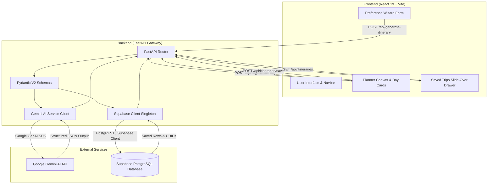

# WanderAI — AI Personalized Travel Itinerary Planner

[](https://fastapi.tiangolo.com)
[](https://python.org)
[](https://react.dev)
[](https://vitejs.dev)
[](https://aistudio.google.com)
[](https://supabase.com)
[](https://docker.com)

> An intelligent, full-stack travel planner that crafts bespoke day-by-day itineraries tailored to your style, budget, interests, and pace using Google Gemini AI, FastAPI, React, and Supabase.

---

## 📌 Table of Contents
- [Project Overview](#-project-overview)
- [Problem Statement & Target Personas](#-problem-statement--target-personas)
- [Key Features](#-key-features)
- [Architecture & Data Flow](#-architecture--data-flow)
- [API Reference](#-api-reference)
- [Technology Stack](#-technology-stack)
- [Local Setup & Environment Instructions](#-local-setup--environment-instructions)
- [Docker & Containerized Deployment](#-docker--containerized-deployment)
- [Project Structure](#-project-structure)
- [Build & Quality Verification](#-build--quality-verification)
- [GitHub Submission Guide](#-github-submission-guide)

---

## 📖 Project Overview

**WanderAI** transforms the stressful, fragmented process of vacation planning into a delightful, 30-second AI-powered experience. By combining **Google Gemini AI** structured JSON output, **FastAPI** validation gateways, a reactive **React 19 / Vite** UI, and **Supabase** PostgreSQL persistence, WanderAI plans complete trips down to morning, afternoon, and evening slots, transit tips, packing checklists, and per-activity budget estimates.

---

## 🎯 Problem Statement & Target Personas

### The Problem
Traditional trip planning is tedious and exhausting. Travelers spend hours juggling guidebooks, blogs, map pins, and spreadsheets. Existing algorithmic generators produce generic cookie-cutter lists that disregard travel pacing, party dynamics, realistic budgets, or the desire to customize individual days.

### Target Personas

| Persona | Core Needs | WanderAI Solution |
| :--- | :--- | :--- |
| 🧍 **Solo Travelers** | Spontaneous exploration, safety advice, budget awareness, cultural immersion. | Curated cultural & food hotspots, walkability tips, individual cost tracking. |
| 👫 **Couples** | Romance, fine dining, picturesque viewpoints, relaxed pacing. | Balanced morning/evening rhythms, intimate dining recommendations, scenic spots. |
| 👨‍👩‍👧‍👦 **Families** | Manageable schedules, kid-friendly venues, essential packing lists, logistics. | "Relaxed" pace option, packing checklists, accessible transit advice. |
| 👯 **Groups & Friends** | Nightlife, adventurous excursions, shared budget transparency. | "Fast-paced" activity clustering, nightlife slots, transparent per-person USD estimates. |

---

## ✨ Key Features

- **🪄 4-Step Interactive Wizard**: Intuitive preference input covering destination, start/end dates with auto duration calculation, budget tiers (Budget, Moderate, Luxury), travel style (Solo, Couple, Family, Friends), 9 interest categories, and travel pace (Relaxed, Balanced, Fast-Paced).
- **⚡ Gemini AI Structured Generation**: Strictly enforced JSON schema generated by Google GenAI SDK (`gemini-3.8-flash` / `gemini-2.5-flash`), eliminating parsing errors and hallucinations.
- **🗺️ Interactive Itinerary Canvas**: Chronological day-by-day plan with morning, afternoon, and evening slots, complete with activity titles, venues/locations, descriptions, and cost estimates.
- **🔄 Single-Day Regeneration**: Refresh any specific day without losing the rest of your itinerary. Context from other days is sent to Gemini to ensure zero duplicate activities.
- **💾 Supabase Cloud Persistence**: Save generated trips to Supabase PostgreSQL with a single click. Every trip receives a unique UUID and full JSON snapshot.
- **🗂️ "My Saved Trips" Slide-Over Drawer**: Responsive glassmorphism drawer accessible from the navigation bar. Re-fetch, browse, and load any past journey back onto the canvas instantly.
- **🖨️ Print & PDF Ready**: Dedicated `@media print` stylesheets format the canvas cleanly for physical printouts or saving as an offline PDF.

---

## 🏗️ Architecture & Data Flow

### Architecture Diagram



### Data Flow Breakdown
1. **Preference Collection**: User inputs trip preferences in the React frontend.
2. **AI Generation**: Frontend sends preferences to FastAPI (`POST /api/generate-itinerary`), which validates inputs with Pydantic and requests structured JSON from Gemini AI via the Google GenAI SDK.
3. **Canvas Rendering**: Gemini returns a JSON itinerary that renders into the reactive Canvas with transit advice, packing essentials, and daily morning/afternoon/evening slots.
4. **Single-Day Regeneration**: Clicking "Refresh Day" on any day card triggers `POST /api/regenerate-day`, passing other days as context to avoid repetitive recommendations.
5. **Persistence**: Clicking "Save Trip" sends the entire itinerary to `POST /api/itineraries/save`, storing it in Supabase and returning a unique UUID.
6. **Past Trip Retrieval**: Opening "My Saved Trips" calls `GET /api/itineraries`. Clicking any saved trip loads its full JSON state back onto the canvas.

---

## 📡 API Reference

All backend endpoints run under `http://localhost:8000`:

| Method | Endpoint | Description | Request Body | Response Format |
| :--- | :--- | :--- | :--- | :--- |
| `GET` | `/health` | Healthcheck endpoint | None | `{"status": "ok"}` |
| `GET` | `/api/db-check` | Verifies Supabase connection & row count | None | `{"status": "connected", "count": 2}` |
| `POST` | `/api/preferences` | Validates preferences wizard payload | `TripPreferenceRequest` (JSON) | `{"status": "received", "summary": {...}}` |
| `POST` | `/api/generate-itinerary` | Generates full day-by-day itinerary via Gemini AI | `TripPreferenceRequest` (JSON) | `{"status": "generated", "itinerary": {...}}` |
| `POST` | `/api/regenerate-day` | Regenerates a single day with existing context | `RegenerateDayRequest` (JSON) | `{"status": "regenerated", "day": {...}}` |
| `POST` | `/api/itineraries/save` | Persists a trip into Supabase `itineraries` table | `SaveItineraryRequest` (JSON) | `{"status": "saved", "id": "<uuid>"}` |
| `GET` | `/api/itineraries` | Retrieves all saved trips (ordered by date desc) | None | `{"status": "success", "itineraries": [...]}` |
| `GET` | `/api/itineraries/{trip_id}` | Retrieves a single saved trip by UUID | None (URL path param) | `{"status": "success", "itinerary": {...}}` |

---

## 🛠️ Technology Stack

- **Frontend**:
  - **React 19** (Functional components, hooks, modern React architecture)
  - **Vite 8** (Ultra-fast build tool and dev server)
  - **Vanilla CSS / Modern Design System** (Glassmorphism, CSS Custom Properties, keyframe animations)
  - **Lucide React** (Clean, consistent icon set)
- **Backend**:
  - **FastAPI** (High-performance async Python web framework)
  - **Pydantic V2** (Strict schema validation and data serialization)
  - **Uvicorn** (Lightning-fast ASGI server)
  - **Python Dotenv** (Secure environment configuration)
- **AI & Cloud**:
  - **Google GenAI SDK** (`google-genai` calling `gemini-3.8-flash` / `gemini-2.5-flash`)
  - **Supabase PostgreSQL** (`supabase-py` client for persistent cloud storage)
- **DevOps & Containers**:
  - **Docker & Docker Compose** (Production containerization)
  - **Nginx Alpine** (Production static SPA server with Gzip compression)
  - **Vercel** (`vercel.json` for SPA rewrites and edge caching)

---

## 💻 Local Setup & Environment Instructions

### 1. Prerequisites
- **Python**: 3.11 or higher
- **Node.js**: 18.0 or higher
- **Git**
- **Google Gemini API Key**: Obtain from [Google AI Studio](https://aistudio.google.com/app/apikey)
- **Supabase Project**: Obtain Project URL & Anon Key from [Supabase Dashboard](https://supabase.com)

---

### 2. Clone the Repository
```bash
git clone https://github.com/your-username/personalized-travel-itinerary-planner.git
cd personalized-travel-itinerary-planner
```

---

### 3. Backend Setup
1. Navigate to the backend directory and create a virtual environment:
   ```bash
   cd backend
   python -m venv venv
   ```
2. Activate the virtual environment:
   - **Windows (PowerShell)**:
     ```powershell
     .\venv\Scripts\Activate.ps1
     ```
   - **macOS / Linux**:
     ```bash
     source venv/bin/activate
     ```
3. Install backend dependencies:
   ```bash
   pip install -r requirements.txt
   ```
4. Create your `.env` configuration file in `backend/`:
   ```bash
   cp .env.example .env
   ```
5. Populate `backend/.env` with your API credentials:
   ```env
   # Gemini API Key - get from https://aistudio.google.com/app/apikey
   GEMINI_API_KEY=your_gemini_api_key_here
   GEMINI_MODEL=gemini-3.8-flash

   # Supabase credentials - get from https://supabase.com/dashboard
   SUPABASE_URL=https://your-project-id.supabase.co
   SUPABASE_KEY=your_supabase_anon_key_here
   ```
6. Start the FastAPI development server:
   ```bash
   uvicorn main:app --reload --port 8000
   ```
   *The API will be available at `http://localhost:8000` (Swagger docs at `http://localhost:8000/docs`).*

---

### 4. Frontend Setup
1. Open a new terminal and navigate to `frontend/`:
   ```bash
   cd frontend
   npm install
   ```
2. Start the Vite development server:
   ```bash
   npm run dev
   ```
   *The web application will be accessible at `http://localhost:5173`.*

---

## 🐳 Docker & Containerized Deployment

Run the complete multi-tier application in production mode using Docker Compose:

```bash
# Build and launch both backend and frontend containers
docker compose up --build
```

- **Frontend Application**: Accessible at `http://localhost:80` (and `http://localhost:5173`)
- **Backend API**: Accessible at `http://localhost:8000`
- **To stop containers**: `docker compose down`

---

## 📂 Project Structure

```
personalized-travel-itinerary-planner/
├── docker-compose.yml             # Production multi-container orchestrator
├── package.json                   # Root scripts & dev tools
├── README.md                      # Executive project documentation
│
├── backend/                       # FastAPI Backend
│   ├── Dockerfile                 # Production Python container
│   ├── .dockerignore              # Backend container ignore rules
│   ├── .env.example               # Template environment variables
│   ├── requirements.txt           # Python dependencies
│   ├── db.py                      # Supabase client singleton
│   ├── main.py                    # FastAPI routes & Pydantic schemas
│   └── services/
│       ├── __init__.py
│       └── gemini_service.py      # Google GenAI SDK integration
│
└── frontend/                      # React 19 + Vite Frontend
    ├── Dockerfile                 # Multi-stage Nginx production container
    ├── .dockerignore              # Frontend container ignore rules
    ├── nginx.conf                 # Nginx server configuration (SPA & Gzip)
    ├── vercel.json                # Vercel deployment & routing rewrites
    ├── package.json               # Node dependencies & build scripts
    ├── vite.config.js             # Vite configuration
    ├── index.html                 # Application entry HTML
    └── src/
        ├── main.jsx               # React DOM entry point
        ├── App.jsx                # Core layout & modal coordination
        ├── index.css              # Custom design system & animations
        └── components/
            ├── Navbar.jsx         # Responsive navbar & Saved Trips trigger
            ├── Hero.jsx           # Animated hero section with CTAs
            ├── PreferenceForm.jsx # 4-step interactive wizard
            ├── Features.jsx       # Value propositions & feature cards
            ├── PlannerCanvas.jsx  # Day-by-day timeline, regeneration & save
            └── SavedTripsModal.jsx# Supabase saved trips slide-over drawer
```

---

## 🧪 Build & Quality Verification

To verify that the production build and lint checks pass cleanly:

```bash
cd frontend

# Run Oxlint static analysis
npm run lint
# Output: Found 0 warnings and 0 errors.

# Run Vite production bundle build
npm run build
# Output: ✓ built in ~400ms
```

---

## 🚀 GitHub Submission Guide

Follow these steps to submit your completed project to GitHub:

1. **Verify your Git status**:
   ```bash
   git status
   ```
2. **Add all project files**:
   ```bash
   git add .
   ```
3. **Commit the final submission**:
   ```bash
   git commit -m "feat: complete WanderAI travel itinerary planner (Epics 1-7)"
   ```
4. **Link to your GitHub remote repository** (if not already linked):
   ```bash
   git remote add origin https://github.com/your-username/personalized-travel-itinerary-planner.git
   ```
5. **Push to main branch**:
   ```bash
   git branch -M main
   git push -u origin main
   ```

---

## 📄 License
This project is open-source and available under the [MIT License](LICENSE).
